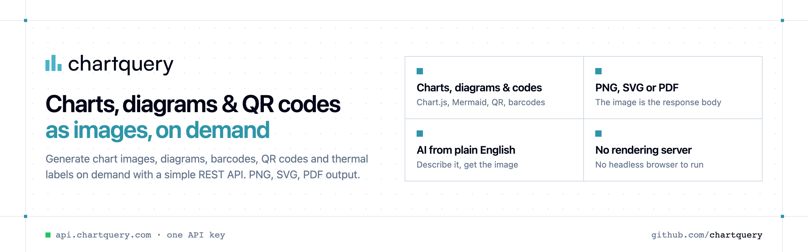

<p align="center">
  <a href="https://www.chartquery.com"></a>
</p>

<p align="center">

[](https://discord.gg/CFj3ph8aHU) [](https://www.chartquery.com) [](https://app.chartquery.com/register) [](https://app.chartquery.com/openapi)

</p>

**ChartQuery** generates **chart images, diagrams, barcodes, QR codes and thermal labels** on demand with a simple REST API — PNG, SVG or PDF output, no rendering server needed. Describe a chart in plain English and AI renders it for you.

### Why ChartQuery?

- **Images in one request** — the response body is the PNG/SVG/PDF, ready for emails, PDFs, dashboards, Slack or `` tags.
- **Charts, diagrams, QR codes, barcodes, labels** — Chart.js configs, 28 diagram languages (Mermaid, Graphviz, PlantUML, D2…), 25+ barcode formats.
- **AI generation** — describe a chart or diagram in plain English and get the rendered image.
- **No rendering infrastructure** — no headless browser, fonts or libraries to maintain.
- **Copy-paste examples** — Python and TypeScript in each README, 7 more languages in `examples/`.

```bash
curl -G https://api.chartquery.com/v1/qrcode \
  -H "x-api-key: $CHARTQUERY_API_KEY" \
  --data-urlencode "data=https://chartquery.com" \
  --data-urlencode "format=png" -o qrcode.png
```

### Repositories

- [**Barcode API**](https://github.com/chartquery/barcode-api) — Generate EAN-13, Code 128, GS1-128 & 25+ barcode formats
- [**Chart API**](https://github.com/chartquery/chart-api) — Render Chart.js charts as images — or describe them in plain English
- [**Diagram API**](https://github.com/chartquery/diagram-api) — Render Mermaid, Graphviz, PlantUML, D2 & more as images
- [**QR Code API**](https://github.com/chartquery/qr-code-api) — Generate styled QR codes as SVG or PNG
- [**Thermal Label API**](https://github.com/chartquery/thermal-label-api) — Preview & compile thermal labels for TSC, ZPL, EPL and more

---

💬 [Discord](https://discord.gg/CFj3ph8aHU) · 📚 [API reference](https://app.chartquery.com/openapi) · 🔑 [Get your API key](https://app.chartquery.com/register) · 🌐 [www.chartquery.com](https://www.chartquery.com)
